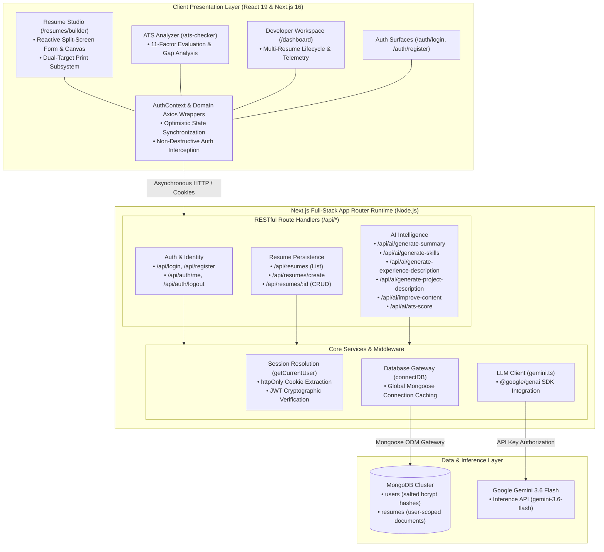
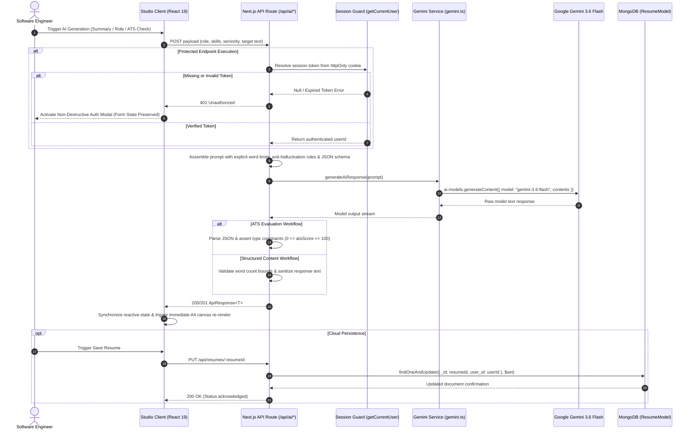

# TypeCast — AI-Powered Resume Engineering & ATS Intelligence Studio

[](#)
[](#)
[](#)
[](#)
[](#)
[](#)
[](#)
[](LICENSE)

TypeCast is a developer-centric, full-stack resume engineering platform built on **Next.js 16 (App Router)**, **React 19**, **TypeScript 5**, and **Google Gemini 3.6 Flash**. It addresses the compound challenge of software engineering resumes: formulating high-signal, quantifiable technical narratives for engineering hiring managers while satisfying the strict topological keyword and parsing heuristics of enterprise Applicant Tracking Systems (ATS).

The platform couples a reactive split-screen document builder with domain-specialized LLM generation workflows, an 11-dimensional ATS scoring pipeline, user-scoped cloud persistence, stateless `httpOnly` session security, and a dual-target print presentation engine.

---

## Table of Contents

- [Executive Summary](#executive-summary)
- [System Architecture](#system-architecture)
- [Core Workflow & AI Pipeline](#core-workflow--ai-pipeline)
- [Tech Stack](#tech-stack)
- [Key Engineering Capabilities](#key-engineering-capabilities)
- [AI Prompt Engineering & Inference Pipeline](#ai-prompt-engineering--inference-pipeline)
- [Data Architecture & Schema Design](#data-architecture--schema-design)
- [Security Architecture & IDOR Mitigation](#security-architecture--idor-mitigation)
- [Dual-Target Print Engine](#dual-target-print-engine)
- [API Architecture & Endpoints](#api-architecture--endpoints)
- [Repository Structure](#repository-structure)
- [Roadmap](#roadmap)
- [License](#license)
- [Author](#author)

---

## Executive Summary

Technical resume creation routinely breaks across two failure modes: human reviewers reject resumes lacking measurable technical depth and architectural context, while algorithmic ATS parsers discard candidates due to missing keyword matrices, irregular structural tags, or non-standard formatting.

TypeCast models resume authoring as a software engineering and structured-data challenge:

1. **Normalized Data Modeling**: Instead of unstructured rich text or static templates, resume data is modeled into strictly typed, decoupled subdocuments (Personal Info, Summary, Technical Skills Matrix, Work History, Engineering Projects, and Credentials).
2. **Dual-Mode Session Architecture**:
   - **Frictionless Guest Workspace**: Unauthenticated users can immediately enter the split-screen studio (`/resumes/builder`), modify all document nodes, observe real-time A4 canvas updates, and trigger print/PDF export without authentication overhead.
   - **Authenticated Cloud Tier**: Account verification grants access to the **Google Gemini 3.6 Flash** generative engine, the **ATS Compatibility Scorer**, and MongoDB-backed multi-resume lifecycle management.
3. **Non-Destructive Context Preservation**: When guest users trigger protected actions (e.g., cloud sync or AI inference), an authentication interception layer captures the requirement without unmounting or wiping active in-memory editor state.

---

## System Architecture

TypeCast operates as a consolidated, full-stack Next.js 16 application running in a Node.js runtime environment. Serverless App Router route handlers encapsulate API endpoints, eliminating the architectural overhead of an auxiliary Express or FastAPI daemon.



### Architectural Layer Responsibilities

- **Client Presentation Layer**: Built on React 19 hooks and Tailwind CSS 4. Features a split-screen reactive workspace with CSS grid layout, dark-mode Obsidian/Emerald design tokens (`--obsidian: #030D0B`, `--emerald: #06D6A0`), and glassmorphic UI components.
- **RESTful API Layer**: Next.js App Router handlers enforce request-body validation, payload typing via `ApiResponse<T>` wrappers, correct HTTP semantics, and granular error isolation.
- **Service & Security Core**: Centralized server libraries manage global Mongoose connection pooling (`src/lib/db.ts`), cryptographic session extraction (`src/lib/getCurrentUser.ts`), and singleton Gemini client orchestration (`src/lib/gemini.ts`).
- **Persistence & Machine Intelligence**: MongoDB stores normalized documents with schema-level validation, while Gemini 3.6 Flash executes structured content generation and parsing evaluation.

---

## Core Workflow & AI Pipeline

The sequence diagram below models the asynchronous orchestration across the client UI, serverless route handlers, session validation guards, the Google Gen AI client, and the database persistence layer:



---

## Tech Stack

| Layer | Technology | Version | Architectural Role |
| :--- | :--- | :--- | :--- |
| **Frontend Architecture** | Next.js | `16.2.7` | App Router framework managing routing, layouts, and serverless execution boundaries |
| | React | `19.2.4` | Component composition, reactive split-screen document state, and lifecycle hooks |
| | TypeScript | `^5` | End-to-end static typing across schemas, API contracts, and client interfaces |
| **Styling & Design** | Tailwind CSS | `^4.3.3` | Utility-first styling with PostCSS integration and custom Obsidian/Emerald theme tokens |
| | Lucide React | `^1.31.0` | Modular UI iconography across navigation, toolbar controls, and section tabs |
| | Google Fonts | Web Fonts | Plus Jakarta Sans (display), Inter (UI body), JetBrains Mono (technical metadata) |
| **Backend & Runtime** | Node.js | `>=18` | Serverless runtime executing App Router API route handlers |
| **AI & Intelligence** | `@google/genai` | `^2.13.0` | Official Google Gen AI SDK invoking `gemini-3.6-flash` for inference and ATS analysis |
| **Database & ODM** | MongoDB | Cloud / Local | Document database storing user credentials and nested resume documents |
| | Mongoose | `^9.6.3` | Schema definition, validation, global connection caching, and lifecycle middleware |
| **Security & Auth** | `jsonwebtoken` | `^9.0.3` | Stateless cryptographic JWT generation and server-side verification |
| | `bcrypt` | `^6.0.0` | Salted cryptographic password hashing enforced via Mongoose `pre("save")` hooks |
| **API Orchestration** | Axios | `^1.19.0` | Promise-based HTTP client organized into domain-specific service abstraction modules |

---

## Key Engineering Capabilities

### 1. Split-Screen Reactive Studio (`/resumes/builder`)
- **Dual-Pane Grid System**: Form controls and live document preview are rendered synchronously using a 5:7 column split layout. Form state mutations immediately re-render the A4 canvas without visible layout shift or input latency.
- **Section Isolation**: Resume segments (Personal, Summary, Skills, Work History, Projects, Education) are organized into decoupled tabs, allowing targeted updates to specific data structures without unmounting adjacent inputs.
- **Dynamic List Controls**: Specialized mutation handlers allow engineers to append, reorder, edit, and prune nested array items (such as work experience achievements or project tech stack tags) with isolated state management.

### 2. Google Gemini 3.6 Flash Content Engine
- **Seniority-Aware Prompting**: AI generation adapts tone, lexical density, and responsibility framing across three seniority tiers:
  - *Fresher*: Focuses on foundational technical skills, academic coursework, and capstone project delivery.
  - *Mid-Level*: Focuses on hands-on feature ownership, system contributions, and cross-functional execution.
  - *Senior*: Focuses on distributed systems architecture, strategic technical decisions, team mentorship, and organizational KPIs.
- **Deterministic Output Contracts**: Endpoints enforce strict length caps (e.g., 50–80 words for executive summaries; 80–120 words for work experience) to preserve document balance and prevent verbosity.

### 3. 11-Factor ATS Score Analyzer (`/ats-checker`)
- **Algorithmic Evaluation Heuristics**: Analyzes candidate resume content against 11 weighted dimensions:
  1. ATS Keyword Optimization & Semantic Density
  2. Structural Completeness & Hierarchy
  3. Executive Summary Impact & Relevance
  4. Work History & Responsibility Framing
  5. Technical Skills Matrix Presentation
  6. Technical Depth & Architectural Scope in Projects
  7. Education & Credential Formatting
  8. Action-Oriented Language Usage
  9. Quantifiable Metrics, Scale, and KPIs
  10. Document Clarity, Formatting, and Parser OCR Feasibility
  11. Overall Role Alignment & Seniority Appropriateness
- **Semantic Gap Analysis**: Accepts an optional target Job Description alongside resume text to detect missing competencies, frameworks, and domain-specific terminology.

### 4. Cloud Resume Workspace (`/dashboard`)
- **Multi-Document Lifecycle Management**: Authenticated engineers can manage distinct versions of their resume tailored for specific job profiles (e.g., Backend vs Full-Stack vs Systems Engineering).
- **Workspace Metrics**: Displays real-time repository metrics including total stored documents, active AI model identifier (`Gemini 3.6 Engine`), and estimated ATS pass probability.

---

## AI Prompt Engineering & Inference Pipeline

Rather than unstructured natural-language chats, TypeCast enforces strict prompt engineering rules designed specifically for automated parsers and engineering reviewers:

| Endpoint | Input Payload | Strict Operational Constraints |
| :--- | :--- | :--- |
| `/api/ai/generate-summary` | `jobTitle`, `skills[]`, `experienceLevel` | Bounded to 50–80 words; plain text only; zero bullet points or markdown headers; zero first-person pronouns (`I`, `me`, `my`); embeds target technologies naturally. |
| `/api/ai/generate-skills` | `jobTitle`, `experienceLevel` | Returns 8–12 role-tailored technical and soft skills as comma-separated plain text; stratified by seniority tier. |
| `/api/ai/generate-experience-description` | `jobRole`, `technologies[]`, `yearsOfExperience`, `experienceLevel` | Bounded to 80–120 words; emphasizes technical ownership, problem-solving, and deliverables; avoids generic buzzwords. |
| `/api/ai/generate-project-description` | `projectName`, `projectTitle`, `projectType`, `role`, `technologies[]`, `experienceLevel` | Bounded to 80–120 words; highlights architectural patterns, tech stack integration, and quantifiable project outcomes. |
| `/api/ai/improve-content` | `content` | Refines raw candidate drafts for active voice, clarity, and keyword density; strictly prohibits inventing unverified skills, achievements, or employment history. |
| `/api/ai/ats-score` | `resumeText` | Evaluates full text against 11 dimensions; outputs validated JSON `{"atsScore": <number>}`; score verified between `0` and `100`; returns HTTP 502 on invalid model output. |

---

## Data Architecture & Schema Design

Persistent entities are modeled using Mongoose schemas in `src/models/` with synchronized TypeScript interfaces in `src/types/`.

### 1. User Entity (`src/models/user.model.ts`)
Encapsulates developer identity and authentication credentials:
- **`name`**: Required string with trimming.
- **`email`**: Unique, required, lowercase-indexed string.
- **`password`**: Required string with length validation (min 4 characters).
- **`mobile`**: Optional 10-digit contact string.
- **`timestamps`**: Automatic `createdAt` and `updatedAt` audit fields.
- **Mongoose Middleware**: A `pre("save")` hook detects password modification and applies `bcrypt.hashSync(this.password, 10)` prior to database persistence.
- **Instance Method**: `comparePassword(candidatePassword: string): boolean` executes constant-time hash comparison for authentication.

### 2. Resume Entity (`src/models/resume.model.ts`)
Encapsulates complete, structured engineering resumes:
- **`user_id`**: ObjectId reference linked to the `User` model, enforcing document ownership.
- **`title`**: Descriptive label (e.g., "Senior Full-Stack Engineer — Cloud Platforms").
- **`summary`**: Executive summary string.
- **`personalInfo`**: Subdocument containing `fullname`, `email`, `mobile`, `location`, `github`, `linkedIn`, and `portfolio`.
- **`education`**: Array of subdocuments containing `institutionName`, `degree`, `startDate`, and `endDate`.
- **`workExperience`**: Array of subdocuments containing `companyName`, `position`, `location`, `startDate`, `endDate`, and `description`.
- **`projects`**: Array of subdocuments containing `title`, `description`, `gitHubUrl`, `liveUrl`, and `techStack` (string array).
- **`skills`**: Array of categorized technical competence strings.
- **`certifications`**: Array of verified credential strings.

---

## Security Architecture & IDOR Mitigation

TypeCast incorporates defense-in-depth security mechanisms designed to protect developer data and prevent common web vulnerabilities:

### 1. Cryptographic Insecure Direct Object Reference (IDOR) Mitigation
All resume mutations derive authorization directly from the server-verified JWT cookie rather than accepting client-provided identity parameters:

```typescript
// Enforces dual-constraint query resolution (Document ID + Verified User ID)
const userId = await getCurrentUser();
const updatedResume = await ResumeModel.findOneAndUpdate(
  { _id: resumeId, user_id: userId },
  { $set: updateData },
  { new: true }
);
```

Even if a malicious actor acquires another candidate's document ID, cross-tenant reads, modifications, or deletions fail with a `404 Not Found` response.

### 2. Stateless `httpOnly` Cookie Transportation
JWT session tokens are stored exclusively inside `httpOnly`, `sameSite`, and environment-aware `secure` cookies (`maxAge: 86400`, `path: "/"`). Because client-side JavaScript cannot read `httpOnly` cookies, session tokens remain protected against Cross-Site Scripting (XSS) credential harvesting.

### 3. Mutation Payload Sanitization
The resume update route explicitly strips immutable and system fields (`_id`, `user_id`, `createdAt`, `updatedAt`) before forwarding updates to Mongoose `$set` operations, eliminating schema pollution and CastErrors.

### 4. Global Connection Caching & Pool Optimization
Serverless route handlers can easily exhaust database connection pools during rapid invocations. In `src/lib/db.ts`, Mongoose connection promises are memoized on the Node.js `global` object, reusing active database sockets across subsequent requests.

---

## Dual-Target Print Engine

Rather than relying on heavy, resource-intensive server-side headless browser instances (such as Puppeteer or Playwright), TypeCast implements a client-side print compilation engine using dedicated CSS `@media print` rules:

1. **Interface Suppression**: All administrative chrome, navigation bars, footer elements, split-screen editor inputs, and action buttons tagged `.no-print` are eliminated via `display: none !important`.
2. **Color & Contrast Inversion**: Dark obsidian themes and glassmorphic card backdrops are stripped. Backgrounds reset to pure `#ffffff` and foreground text to high-contrast `#000000`.
3. **Physical Sheet Dimensioning**: `@page { size: A4; margin: 12mm 15mm; }` enforces standard international A4 document boundaries.
4. **Optical Scan Typography Switching**: The printable document canvas (`.resume-print-area`) dynamically overrides the application's sans-serif font family, switching to formal high-contrast serif typography (`Georgia, Cambria, "Times New Roman", Times, serif`). This matches executive document conventions and maximizes OCR parsing accuracy for enterprise ATS scanners.

---

## API Architecture & Endpoints

All endpoints conform to standard HTTP semantics and return strongly typed JSON envelopes adhering to the `ApiResponse<T>` contract (`{ success: boolean, message?: string, data?: T }`).

### Authentication Domain

- **`POST /api/register`**
  - Registers a new developer account.
  - Body: `{ name: string, email: string, password: string, mobile?: string }`
  - Status: `201 Created` / `400 Bad Request`

- **`POST /api/login`**
  - Authenticates credentials and sets an `httpOnly` session cookie (`token`).
  - Body: `{ email: string, password: string }`
  - Status: `200 OK` (Set-Cookie) / `401 Unauthorized` / `404 Not Found`

- **`GET /api/auth/me`**
  - Validates active session and retrieves user profile (excluding password).
  - Status: `200 OK` / `401 Unauthorized`

- **`POST /api/auth/logout`**
  - Invalidates session by setting an expired cookie.
  - Status: `200 OK`

### Resume Persistence Domain

- **`GET /api/resumes`**
  - Lists all resumes belonging to the authenticated user, sorted by `updatedAt: -1`.
  - Status: `200 OK` / `401 Unauthorized`

- **`POST /api/resumes/create`**
  - Instantiates a new structured resume record bound to the authenticated user ID.
  - Body: `Partial<IResume>`
  - Status: `201 Created` / `401 Unauthorized`

- **`GET /api/resumes/:resumeId`**
  - Retrieves a specific resume document enforcing owner scoping.
  - Status: `200 OK` / `404 Not Found`

- **`PUT /api/resumes/:resumeId`**
  - Sanitizes payload and executes atomic `$set` update on the user-scoped document.
  - Body: `Partial<IResume>`
  - Status: `200 OK` / `404 Not Found`

- **`DELETE /api/resumes/:resumeId`**
  - Deletes a specific resume document enforcing owner scoping.
  - Status: `200 OK` / `404 Not Found`

### AI & ATS Intelligence Domain

- **`POST /api/ai/generate-summary`**
  - Generates a concise ATS-tailored executive summary (50–80 words).
  - Auth: Protected.
  - Body: `{ jobTitle: string, skills: string[], experienceLevel: string }`
  - Status: `201 Created` / `400 Bad Request` / `401 Unauthorized`

- **`POST /api/ai/generate-skills`**
  - Generates an 8–12 item role-tailored technical and soft skills matrix.
  - Body: `{ jobTitle: string, experienceLevel: string }`
  - Status: `201 Created` / `400 Bad Request`

- **`POST /api/ai/generate-experience-description`**
  - Generates an 80–120 word role description tailored to seniority level.
  - Body: `{ jobRole: string, technologies: string[], yearsOfExperience: number, experienceLevel: string }`
  - Status: `201 Created` / `400 Bad Request`

- **`POST /api/ai/generate-project-description`**
  - Generates an 80–120 word technical project description with architectural context.
  - Body: `{ projectName: string, projectTitle: string, projectType: string, role: string, technologies: string[], experienceLevel: string }`
  - Status: `201 Created` / `400 Bad Request`

- **`POST /api/ai/improve-content`**
  - Polishes existing candidate text for action verbs and keyword density without inventing facts.
  - Body: `{ content: string }`
  - Status: `200 OK` / `400 Bad Request`

- **`POST /api/ai/ats-score`**
  - Evaluates complete resume text across 11 dimensions and returns validated JSON.
  - Auth: Protected.
  - Body: `{ resumeText: string }`
  - Status: `200 OK` (`{ atsScore: number }`) / `400 Bad Request` / `401 Unauthorized` / `502 Bad Gateway`

---

## Repository Structure

```
TypeCast/
├── src/
│   ├── apis/                   # Domain-abstracted client HTTP services (Axios)
│   │   ├── ai.api.ts           # AI inference & ATS scoring API wrappers
│   │   ├── auth.api.ts         # Session lifecycle & credential API wrappers
│   │   └── resume.api.ts       # Resume CRUD service wrappers
│   ├── app/                    # Next.js 16 App Router hierarchy
│   │   ├── api/                # Serverless RESTful route handlers
│   │   │   ├── ai/             # 6 Gemini 3.6 Flash inference route handlers
│   │   │   ├── auth/           # /api/auth/me and /api/auth/logout
│   │   │   ├── login/          # /api/login route handler
│   │   │   ├── register/       # /api/register route handler
│   │   │   └── resumes/        # /api/resumes, /create, and /[resumeId] handlers
│   │   ├── ats-checker/        # Dedicated ATS Compatibility Analyzer page
│   │   ├── auth/               # Authenticated login and register view controllers
│   │   ├── dashboard/          # Developer resume workspace and telemetry
│   │   ├── resumes/builder/    # Split-screen reactive resume builder studio
│   │   ├── globals.css         # Theme design tokens, glassmorphism, @media print CSS
│   │   ├── layout.tsx          # Root layout specifying font variables & global context
│   │   └── page.tsx            # Landing page showcasing platform capabilities
│   ├── components/             # Reusable UI component modules
│   │   ├── Footer.tsx          # Application footer
│   │   └── Navbar.tsx          # Dynamic session-aware header navigation
│   ├── context/
│   │   └── AuthContext.tsx     # Global React Context providing session state
│   ├── lib/                    # Server-side utilities and singletons
│   │   ├── db.ts               # Cached Mongoose connection gateway
│   │   ├── gemini.ts           # Centralized Google Gen AI SDK client
│   │   ├── getCurrentUser.ts   # Cookie-based session resolution & JWT verification
│   │   └── jwt.ts              # Cryptographic token signing and decoding
│   ├── models/                 # Mongoose data models with lifecycle middleware
│   │   ├── resume.model.ts     # Resume document schema & subdocument definitions
│   │   └── user.model.ts       # User document schema with pre-save bcrypt hook
│   └── types/                  # TypeScript interface contracts
│       ├── ai.types.ts         # AI request payloads & ATS scoring schema
│       ├── api.types.ts        # Generic ApiResponse<T> envelope interface
│       ├── resume.types.ts     # Resume domain entities and subdocument types
│       └── user.types.ts       # User account, auth payloads, and JWT signatures
├── LICENSE                     # GNU General Public License v3.0
├── next.config.ts              # Next.js compiler and build configuration
├── package.json                # Project dependencies and script declarations
├── postcss.config.mjs          # PostCSS configuration for Tailwind CSS 4
└── tsconfig.json               # TypeScript strict configuration and module aliases
```

---

## Roadmap

- [ ] **Multi-Theme Compilation Engine**: Switchable layout presets (Modern Minimalist, Academic CV, Executive Serif) with independent typographical rules.
- [ ] **Automated Headless PDF Generation**: Optional server-side PDF compilation worker (via Puppeteer) for direct downloads.
- [ ] **In-Canvas Keyword Heatmap**: Real-time visual annotations highlighting matched and missing keywords against an uploaded Job Description.
- [ ] **Point-in-Time Version Snapshotting**: Document revision history with one-click restore capabilities.
- [ ] **Markdown / LaTeX Source Export**: Direct export of raw structured text for developers maintaining local TeX pipelines.

---

## License

This project is licensed under the **GNU General Public License v3.0** — see the [LICENSE](LICENSE) file for details.

---

## Author

**Sk Ramiz Raza**
- GitHub: [@Ramiz123](https://github.com/Ramiz123)
